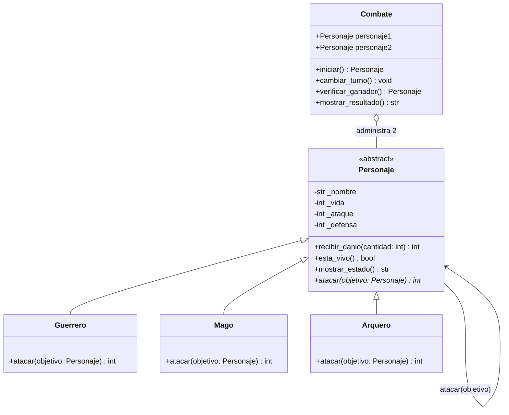

# Guardians of the Ancient Kingdom

Proyecto de Programación Orientada a Objetos en Python.

## 1. Descripción
Es un simulador de combate por turnos entre tres tipos de personajes: Guerrero, Mago y Arquero. Cada personaje tiene su propia forma de atacar y calcular el daño. El programa valida que los datos ingresados sean correctos (que no haya vida negativa ni nombres vacíos), turna los ataques entre dos personajes y define si hay un ganador o empate.

## 2. Estructura del proyecto
El repositorio contiene tres archivos:
- `personajes.py`: define las clases `Personaje`, `Guerrero`, `Mago`, `Arquero` y `Combate`. Contiene los atributos, validaciones, getters, setters y métodos. No ejecuta código por sí solo al importarse.
- `main.py`: crea los personajes, ejecuta los 12 casos de prueba obligatorios mostrando los resultados en consola y contiene las funciones de prueba para pytest.
- `README.md`: documentación que explica el funcionamiento general, las clases, las relaciones y las pruebas.

## 3. Clases del sistema
- `Personaje`: clase abstracta base. Reúne los atributos comunes (`nombre`, `vida`, `ataque`, `defensa`), las validaciones mediante getters y setters, y los métodos `recibir_danio()`, `esta_vivo()` y `mostrar_estado()`. Define el método abstracto `atacar(objetivo)`.
- `Guerrero`: hereda de `Personaje`. Su ataque especial aumenta su fuerza un 20% antes de restar la defensa rival.
- `Mago`: hereda de `Personaje`. Su ataque ignora por completo la defensa del rival (hace daño directo).
- `Arquero`: hereda de `Personaje`. Si su ataque es mayor a la defensa del rival, duplica la diferencia; si no, hace 0 de daño.
- `Combate`: maneja la pelea entre dos personajes. Alterna turnos, revisa la vida de cada participante, cuenta las rondas y define si alguien ganó o si hubo empate (por 0 daño en una ronda o al llegar a 50 rondas).

## 4. Relaciones entre clases
- **Herencia**: `Guerrero`, `Mago` y `Arquero` heredan de `Personaje`. Se usa porque todos son personajes y comparten atributos y comportamiento básico, evitando duplicar código.
- **Asociación**: un `Personaje` interactúa con otro en el método `atacar(objetivo)`. El atacante consulta la defensa del objetivo y le llama a su método `recibir_danio()`. Se usa porque los dos personajes colaboran en una acción puntual sin que uno sea dueño del otro.
- **Agregación**: `Combate` recibe dos personajes creados por fuera. Se usa agregación porque el combate solo administra la pelea; si el combate termina o se destruye, los personajes siguen existiendo por su cuenta.

## 5. Conceptos de POO aplicados
- **Abstracción**: `Personaje` sirve de molde general y no se puede instanciar directamente. Obliga a que cada subclase defina cómo ataca.
- **Encapsulamiento**: los atributos `_nombre`, `_vida`, `_ataque` y `_defensa` son privados/protegidos. Se controlan con `@property` y `@setter` para que no puedan tener valores inválidos (como vida mayor a 100 o negativa).
- **Herencia**: las subclases aprovechan los métodos y atributos de `Personaje` y solo implementan su propio método de ataque.
- **Polimorfismo**: en `Combate`, al llamar a `self.atacante.atacar(self.defensor)`, el código no necesita comprobar qué tipo de personaje es con `if`. Cada objeto ataca según su propia fórmula.

## 6. Lógica del combate

### Cálculo del daño
Primero se valida que ambos personajes sigan vivos. Luego se calcula el daño según la clase:
- **Guerrero**: daño = max(0, int(ataque * 1.20) - defensa_objetivo)
- **Mago**: daño = ataque
- **Arquero**: si ataque > defensa_objetivo, daño = (ataque - defensa_objetivo) * 2; de lo contrario, daño = 0.

Luego se llama a `objetivo.recibir_danio(daño)`. Este método descuenta la vida sin dejarla por debajo de 0 y retorna el daño real recibido.

### Turnos y rondas
1. El primer personaje empieza atacando y el segundo defiende.
2. Cada dos turnos se cuenta una ronda.
3. Si en una ronda completa ninguno se hizo daño, termina en empate técnico.
4. Si se llega a 50 rondas sin ganador, se declara empate por límite de rondas.
5. Si la vida de un personaje llega a 0 tras un ataque, el combate termina inmediatamente y se define el ganador.

## 7. Cómo descargar y ejecutar el programa
Requisitos: tener instalado Python 3.

1. Clonar el repositorio y entrar a la carpeta:
```bash
git clone <URL_DE_TU_REPOSITORIO>
cd Guardians-of-the-Ancient-Kingdom
```

2. Para ejecutar las pruebas en consola y ver el combate de demostración:
```bash
python main.py
```

3. Para ejecutar las pruebas automatizadas con pytest (opcional):
```bash
pytest main.py -v
```

## 8. Casos de prueba comprobados
En `main.py` se prueban los 12 casos obligatorios:
1. Creación correcta de Guerrero, Mago y Arquero.
2. Rechazo de vida mayor a 100 o negativa.
3. Rechazo de nombre vacío o con solo espacios.
4. Rechazo de ataque menor o igual a 0 y defensa negativa.
5. Habilidad de Guerrero (ataque 30 vs defensa 10 da 26 de daño).
6. Habilidad de Mago (ataque 40 vs defensa 20 da 40 de daño ignorando defensa).
7. Habilidad de Arquero (ataque 35 vs defensa 15 da 40 de daño).
8. La vida nunca baja de 0 (con 20 de vida recibe 40 de daño y queda en 0).
9. Un personaje con vida 0 no puede atacar.
10. Combate completo entre Arthas y Gandalf por turnos.
11. Verificación del ganador (gana Gandalf en el turno 6 con 2 de vida).
12. Empate técnico cuando dos personajes no se hacen daño en una ronda.

## 9. Reto extra 1: Diagrama de clases UML



Explicación:
- `Personaje` es la clase abstracta padre.
- `Guerrero`, `Mago` y `Arquero` heredan de `Personaje`.
- La relación entre personajes es de asociación cuando uno ataca a otro.
- `Combate` usa agregación porque recibe dos personajes que existen de forma independiente.

## 10. Reto extra 2: Pruebas con Pytest
Se incluyeron funciones de prueba en `main.py` para validar automáticamente las reglas del programa.

Comando:
```bash
pytest main.py -v
```

Resultado:
```text
main.py::test_creacion_personajes PASSED
main.py::test_clase_abstracta PASSED
main.py::test_rechazo_vida_invalida PASSED
main.py::test_rechazo_nombre_vacio PASSED
main.py::test_rechazo_ataque_y_defensa_invalidos PASSED
main.py::test_habilidad_guerrero PASSED
main.py::test_habilidad_mago PASSED
main.py::test_habilidad_arquero PASSED
main.py::test_vida_nunca_negativa PASSED
main.py::test_derrotado_no_puede_atacar PASSED
main.py::test_combate_completo_y_ganador PASSED
main.py::test_combate_empate_tecnico PASSED

============================= 12 passed in 0.04s ==============================
```

## 11. Reto extra 3: Reto de abstracción

### ¿Por qué `atacar()` debe ser abstracto pero `recibir_danio()` puede implementarse en la clase base?

1. **`recibir_danio(cantidad)` está en `Personaje`**:
Porque la forma en que se descuenta la vida funciona exactamente igual para cualquier personaje. Una vez calculado el daño, da igual si quien recibe el golpe es Guerrero, Mago o Arquero: a todos se les resta la vida con la misma regla (no bajar de 0 y devolver cuánto daño se aplicó). 

Por ejemplo, en el combate de prueba, cuando Gandalf ataca a Arthas en el turno 6: Arthas tiene 20 de vida y el ataque es de 40. `recibir_danio(40)` deja la vida de Arthas en 0 y devuelve 20 de daño efectivo. Esa misma lógica funcionaría de forma idéntica si el defensor fuera un Mago o un Arquero, por lo que dejarla en `Personaje` aprovecha la herencia y evita repetir código.

2. **`atacar(objetivo)` debe ser abstracto**:
Porque no hay una sola fórmula de ataque que sirva para todos. Cada orden ataca con reglas distintas:
- El Guerrero aumenta su fuerza un 20% antes de restar la defensa rival.
- El Mago ignora la defensa rival y hace daño directo.
- El Arquero duplica el daño si supera la defensa, o hace 0 si no la supera.

Al declararlo abstracto en `Personaje`, obligamos a cada subclase a implementar su propia lógica. Además, esto permite aplicar polimorfismo: en `Combate.iniciar()`, el programa simplemente llama a `self.atacante.atacar(self.defensor)` sin preocuparse por cuál subclase es, y cada personaje resuelve su ataque por su cuenta.
